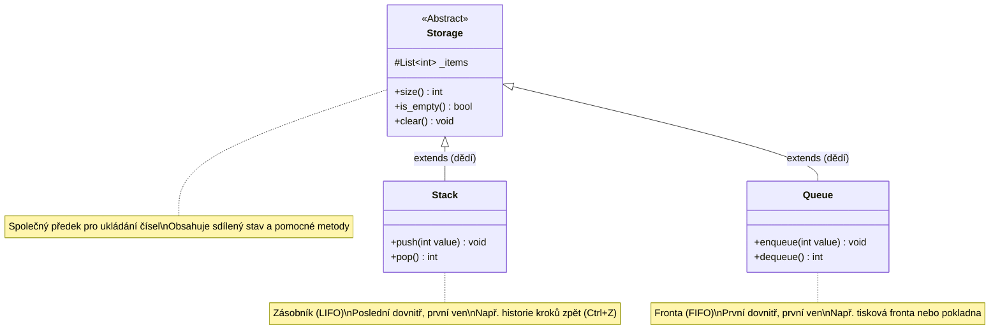

# Hierarchie úložišť dat: Storage, Stack (LIFO) a Queue (FIFO)

Tento dokument vysvětluje objektový návrh a princip fungování základních datových struktur v této úloze: **abstraktního úložiště**, **zásobníku** a **fronty**.

---

## 1. Návrh tříd (Class Diagram)



---

## 2. Klíčové OOP koncepty použité v návrhu

### A. Dědičnost (Inheritance)
* Třída **`Storage`** je společný rodič (předek).
* Třídy **`Stack`** a **`Queue`** jsou potomci. Automaticky zdědí metody `size()`, `is_empty()` a `clear()`, aniž by je musely psát znovu (znovupoužitelnost kódu, DRY – *Don't Repeat Yourself*).

### B. Zapouzdření (Encapsulation) a chráněný stav `_items`
* Seznam čísel je uložen v atributu `self._items`.
* Počáteční podtržítko `_` je v Pythonu konvence pro **chráněný atribut (protected)**.
* Říká: *„Na tento seznam nesahejte zvenčí napřímo. Používejte metody třídy (`size()`, `push()`, atd.).“*

### C. Abstraktní třída (`ABC`)
* `Storage` dědí z `abc.ABC` (*Abstract Base Class*).
* Reprezentuje obecný koncept úložiště, nikoliv konkrétní datovou strukturu. Slouží jako základní stavební kámen pro odvozené třídy.

---

## 3. Podrobný rozbor jednotlivých tříd

### 1. `Storage` (Základní úložiště)
Definuje společné chování pro jakékoliv úložiště čísel:
* **`size() -> int`**: Vrátí aktuální počet uložených prvků (`len(self._items)`).
* **`is_empty() -> bool`**: Vrátí `True`, pokud je úložiště prázdné (`size() == 0`).
* **`clear() -> None`**: Vyprázdní celé úložiště a smaže všechny prvky.

---

### 2. `Stack` (Zásobník – princip LIFO)

* **Zkratka LIFO:** *Last In, First Out* (Poslední dovnitř, první ven).
* **Reálná metafora:** 
  * Stoh talířů na stole – nový talíř položíte nahoru a při mytí berete zase ten vrchní.
  * Historie změn v editoru (tlačítko **Undo / Ctrl+Z**) – jako první vrátíte zpět akci, kterou jste udělali jako úplně poslední.
  * Zásobník pistolových nábojů.

#### Klíčové metody:
* **`push(value: int)`**: Vloží nové číslo na vrchol zásobníku (na konec vnitřního seznamu: `append`).
* **`pop() -> int`**: Odebere a vrátí prvek z vrcholu zásobníku.
  * **Chybový stav:** Pokud je zásobník prázdný, vyvolá výjimku `IndexError("Nelze volat pop() na prázdném zásobníku.")`.

---

### 3. `Queue` (Fronta – princip FIFO)

* **Zkratka FIFO:** *First In, First Out* (První dovnitř, první ven).
* **Reálná metafora:** 
  * Fronta lidí u pokladny v supermarketu – kdo přišel první, je také první obsloužen.
  * Tisková fronta u tiskárny – dokument odeslaný jako první se také vytiskne první.
  * Zprávy v chatovací aplikaci.

#### Klíčové metody:
* **`enqueue(value: int)`**: Zařadí nové číslo na konec fronty (`append`).
* **`dequeue() -> int`**: Odebere a vrátí prvek ze začátku fronty (`pop(0)`).
  * **Chybový stav:** Pokud je fronta prázdná, vyvolá výjimku `IndexError("Nelze volat dequeue() na prázdné frontě.")`.

---

## 4. Porovnání LIFO vs. FIFO na konkrétních číslech

Představme si, že do prázdného zásobníku i fronty postupně vložíme čísla **10**, **20** a **30**:

```text
Vstup: vložíme 10, pak 20, pak 30

┌────────────────────────────────────────────────────────┐
│                   ZÁSOBNÍK (STACK)                     │
│                                                        │
│   Vkládání (push):        Výběr (pop) - LIFO:          │
│   [ 30 ]  <-- vrchol       1. výběr => 30              │
│   [ 20 ]                   2. výběr => 20              │
│   [ 10 ]  <-- dno          3. výběr => 10              │
└────────────────────────────────────────────────────────┘

┌────────────────────────────────────────────────────────┐
│                    FRONTA (QUEUE)                      │
│                                                        │
│   Konec fronty (enqueue)       Začátek fronty (dequeue)│
│   [ 30 ] ---> [ 20 ] ---> [ 10 ] => ven (FIFO)        │
│                                                        │
│   1. výběr => 10                                       │
│   2. výběr => 20                                       │
│   3. výběr => 30                                       │
└────────────────────────────────────────────────────────┘
```

---

## 5. Ukázka použití v Pythonu

```python
from src.storage import Stack, Queue

# --- Práce se Zásobníkem ---
s = Stack()
s.push(1)
s.push(2)
print(s.pop())  # Vypíše: 2 (poslední přidaný)
print(s.pop())  # Vypíše: 1

# --- Práce s Frontou ---
q = Queue()
q.enqueue(1)
q.enqueue(2)
print(q.dequeue())  # Vypíše: 1 (první přidaný)
print(q.dequeue())  # Vypíše: 2

# --- Společné metody zděděné ze Storage ---
print(s.is_empty())  # True
print(q.size())      # 0
```
