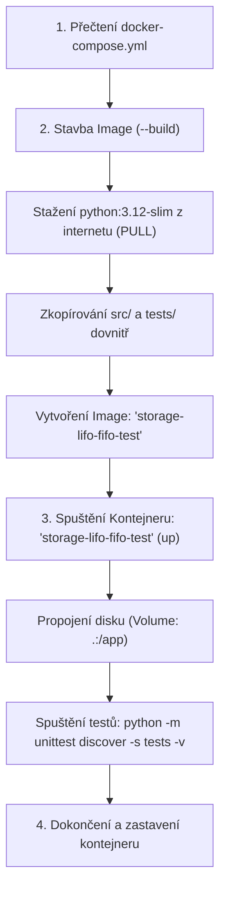

# Co se stalo při spuštění `docker compose up --build`?

Tento průvodce vysvětluje Docker lidsky a polopaticky na příkladu tvého projektu.

---

## 1. Základní pojmy: Image vs. Kontejner

Představ si to jako pečení bábovky:
* **Dockerfile** = **Recept**. Textový návod krok za krokem: vezmi základní suroviny, přidej soubory, nastav pravidla.
* **Image (Obraz)** = **Forma na bábovku / předpřipravené těsto**. Je to hotový zabalený balíček se systémem, Pythonem a tvým kódem. Sám o sobě nic nedělá, jen leží na disku.
* **Kontejner** = **Upečená bábovka / reálný běžící proces**. Živá instance vytvořená z daného Image.
* **docker-compose.yml** = **Manažer / dirigent**. Popisuje, jaké kontejnery spustit, jaké složky z počítače do nich propojit a jaké příkazy provést.

---

## 2. Krok za krokem: Co udělal příkaz `docker compose up --build`



### Krok 1: Čtení konfigurace (`docker-compose.yml`)
Docker Compose si přečetl soubor [docker-compose.yml](../docker-compose.yml). Našel tam definovanou službu s názvem **`tests`**, kde jsou nastavené vlastní názvy:
* `container_name: storage-lifo-fifo-test`
* `image: storage-lifo-fifo-test`

### Krok 2: Sestavení obrazu (`--build`)
Protože jsi přidal přepínač `--build`, Docker nejdříve otevřel tvůj [Dockerfile](../Dockerfile) a sestavil Image:
1. `FROM python:3.12-slim`: Stáhl (PULL) z internetu (Docker Hubu) odlehčenou instalaci Linuxu s Pythonem 3.12.
2. `WORKDIR /app`: Uvnitř připravil pracovní složku `/app`.
3. `COPY src/ ./src/` a `COPY tests/ ./tests/`: Zkopíroval složky s kódem i testy z počítače dovnitř do obrazu.
4. **Výsledek sestavení**: Uložil hotový obraz na disk přímo pod názvem **`storage-lifo-fifo-test`** (velikost cca 177 MB).

### Krok 3: Spuštění kontejneru (`up`)
Docker vzal právě vytvořený obraz `storage-lifo-fifo-test` a spustil z něj kontejner pojmenovaný **`storage-lifo-fifo-test`**:
1. Propojil tvůj aktuální adresář na disku se složkou `/app` v kontejneru (`volumes: .:/app`).
2. Spustil příkaz: `python -m unittest discover -s tests -v`.

### Krok 4: Spuštění testů a ukončení
1. Python v kontejneru spustil jednotkové testy.
2. Do konzole vypsal výsledky.
3. Jakmile testy doběhly, skript skončil. Kontejner splnil svůj úkol a **vypnul se** (v Docker Desktop je šedý / zastavený, což šetří výkon).

---

## 3. Názvy v Docker Desktopu: Automatické vs. Vlastní

### Výchozí chování (když nic nenastavíš)
Pokud v `docker-compose.yml` nezadáš `container_name` ani `image`, Docker Compose použije automatický vzorec:
$$\text{Název složky} + \text{Název služby v compose} + \text{Pořadové číslo}$$
* Původně tedy vznikl image `work-tests` a kontejner `work-tests-1` (pod složkou `work`).

### Naše aktuální nastavení (vlastní pojmenování)
Do [docker-compose.yml](docker-compose.yml) jsme přidali:
```yaml
services:
  tests:
    container_name: storage-lifo-fifo-test
    image: storage-lifo-fifo-test
    build: .
    volumes:
      - .:/app
    command: python -m unittest test_storage.py -v
```
Díky tomu se nyní:
* **V záložce Images** zobrazuje přesně: **`storage-lifo-fifo-test`**
* **V záložce Containers** zobrazuje přesně: **`storage-lifo-fifo-test`**

---

## 4. Co znamenají operace BUILD, PULL a PUSH?

| Operace | Co dělá | Směr toku dat |
| :--- | :--- | :--- |
| **`BUILD`** | **Vyrobí** nový obraz na tvém PC podle návodu v [Dockerfile](Dockerfile). | Lokální kód $\rightarrow$ Lokální Image |
| **`PULL`** | **Stáhne** existující hotový obraz z internetu (Docker Hubu) do tvého PC (např. `python:3.12-slim`). | Internet $\rightarrow$ Lokální Image |
| **`PUSH`** | **Nahraje** tvůj lokální obraz na internet (Docker Hub / firemní registr), aby si ho mohl stáhnout kdokoliv jiný. | Lokální Image $\rightarrow$ Internet |

---

## 5. Význam instrukcí v Dockerfile řádek po řádku

Podívejme se na tvůj [Dockerfile](Dockerfile):

```dockerfile
# 1. Základní stavební kámen
FROM python:3.12-slim

# 2. Nastavení pracovní složky uvnitř kontejneru
WORKDIR /app

# 3. Proměnné prostředí
ENV PYTHONDONTWRITEBYTECODE=1
ENV PYTHONUNBUFFERED=1

# 4. Zkopírování souborů
COPY storage.py test_storage.py ./

# 5. Výchozí příkaz
CMD ["python", "-m", "unittest", "test_storage.py", "-v"]
```

### Podrobný rozbor:
* **`FROM python:3.12-slim`**: 
  * Určuje výchozí operační systém a prostředí.
  * Místo instalace celého velkého Ubuntu s gigabajty balíčků vezme `slim` verzi Debianu s již předinstalovaným Pythonem 3.12 (zabírá minimum místa).
* **`WORKDIR /app`**:
  * Udělá dvě věci naráz: vytvoří v kontejneru složku `/app` (pokud neexistuje) a rovnou se do ní přepne (ekvivalent linuxového `mkdir /app && cd /app`).
  * Všechny další příkazy (`COPY`, `CMD`, `RUN`) se budou dít uvnitř této složky.
* **`ENV PYTHONDONTWRITEBYTECODE=1`**:
  * Říká Pythonu: *„Nevytvářej složky `__pycache__` a soubory `.pyc` na disku.“* V kontejneru to šetří místo a zbytečně to neznečišťuje svazky.
* **`ENV PYTHONUNBUFFERED=1`**:
  * Říká Pythonu: *„Všechny výpisy (`print`, chyby, logy) posílej do konzole okamžitě, neukládej je do vyrovnávací paměti.“* Díky tomu vidíš výstupy v terminálu v reálném čase.
* **`COPY storage.py test_storage.py ./`**:
  * Zkopíruje soubory z tvého počítače (z adresáře, kde je Dockerfile) do aktuálního pracovního adresáře v kontejneru (díky `WORKDIR /app` je to `/app/`).
* **`CMD ["python", "-m", "unittest", "test_storage.py", "-v"]`**:
  * Definuje, co se má spustit, když se kontejner nastartuje.
  * Formát závorek `["příkaz", "arg1", "arg2"]` je doporučený (tzv. Exec formát), protože spouští proces napřímo bez zbytečného shell obalu.

---

## 6. Záleží na pořadí příkazů?

### V Dockerfile: **ROZHODNĚ ANO! Záleží na něm zásadně.**
Důvody jsou dva: **logika** a **Docker Cache (mezipaměť)**.

1. **Logická návaznost:**
   * Nemůžeš dělat `WORKDIR /app` před `FROM`, protože ještě nemáš systém.
   * Nemůžeš spouštět skript dříve, než ho pomocí `COPY` do kontejneru zkopíruješ.
   * `FROM` musí být v Dockerfile vždy **první** netriviální instrukce.

2. **Docker Caching (rychlost stavby):**
   * Docker staví obraz po vrstvách (každý řádek = jedna vrstva).
   * Když Dockerfile spouštíš znovu, Docker se podívá: *„Změnil se tento řádek nebo soubory v něm?“*
   * Pokud **NE**, použije hotový mezivýsledek z cache (trvá to 0.001 s).
   * Jakmile se ale nějaký řádek **změní**, Docker zneplatní cache pro daný řádek a **VŠECHNY ŘÁDKY POD NÍM** musí provést znovu od nuly!
   * **Zlaté pravidlo Dockerfile:**
     * Nahoru dávej věci, které se **nemění téměř nikdy** (`FROM`, `ENV`, instalace systémových balíčků).
     * Dolů dávej věci, které se **mění pořád** (`COPY` tvého zdrojového kódu, který edituješ každou minutu).

### V docker-compose.yml: **NEZÁLEŽÍ (téměř vůbec)**
* Soubor `docker-compose.yml` je formát YAML, což je datová struktura (slovník klíč-hodnota).
* Jestli uvnitř `services.tests` napíšeš nejdříve `build: .` a pak `volumes:`, nebo obráceně, je Dockeru úplně jedno.
* Jediné, na čem záleží, je správné **odsazení mezerami** (struktura stromu).

---

## 7. Propojení: Dockerfile vs. docker-compose.yml

Všimni si, že máš spouštěcí příkaz definovaný na dvou místech:
1. V **Dockerfile**: `CMD ["python", "-m", "unittest", "discover", "-s", "tests", "-v"]`
2. V **docker-compose.yml**: `command: python -m unittest discover -s tests -v`

**Kdo vyhrává?**
Nastavení v [docker-compose.yml](../docker-compose.yml) má **přednost**. Přepíše to, co je v Dockerfile. `CMD` v Dockerfile slouží jako výchozí záloha pro případ, že bys kontejner spouštěl přímo čistým příkazem `docker run` bez Docker Compose.

---

## 8. Jak zrušit kontejner a image (Úklid)

> **Důležité pravidlo:**  
> Docker ti **nedovolí smazat Image**, dokud z něj existuje nějaký kontejner (i kdyby byl zastavený).  
> **Správný postup:** Vždy nejdříve **zastavit a smazat kontejner** $\rightarrow$ až potom **smazat image**.

### Možnost A: Přes terminál (CLI)

#### 1. Nejrychlejší úklid přes Docker Compose (kontejner i image naráz):
Přímo ze složky projektu:
```bash
docker compose down --rmi local
```
* `down`: Zastaví a smaže kontejnery a sítě vytvořené compossem.
* `--rmi local`: Smaže i lokálně postavený image (`storage-lifo-fifo-test`).

#### 2. Krok za krokem pomocí čistého Dockeru:
```bash
# 1. Zastavení běžícího kontejneru:
docker stop storage-lifo-fifo-test

# 2. Smazání zastaveného kontejneru:
docker rm storage-lifo-fifo-test

# Nebo zastavení a smazání naráz jedním příkazem:
docker rm -f storage-lifo-fifo-test

# 3. Smazání samotného Image (rmi = remove image):
docker rmi storage-lifo-fifo-test
```

---

### Možnost B: Přímo v Docker Desktop (klikáním)

1. **Smazání kontejneru:**
   * Přejdi do záložky **Containers**.
   * Najdi `storage-lifo-fifo-test`.
   * Pokud má zelenou tečku (běží), klikni nejdříve na **čtvereček (Stop)**.
   * Poté klikni na **ikonku popelnice (Delete)**.

2. **Smazání Image:**
   * Přejdi do záložky **Images**.
   * Najdi v seznamu `storage-lifo-fifo-test`.
   * Klikni na **ikonku popelnice (Delete)** vpravo na konci řádku.

---

### Tip: Generální úklid disku (`prune`)
Pokud se ti v Dockeru po delší době nahromadí staré zastavené kontejnery a mezivrstvy zabírající gigabajty:
```bash
docker system prune
```
Tento příkaz bezpečně promaže všechny neaktivní věci a uvolní místo na disku.

